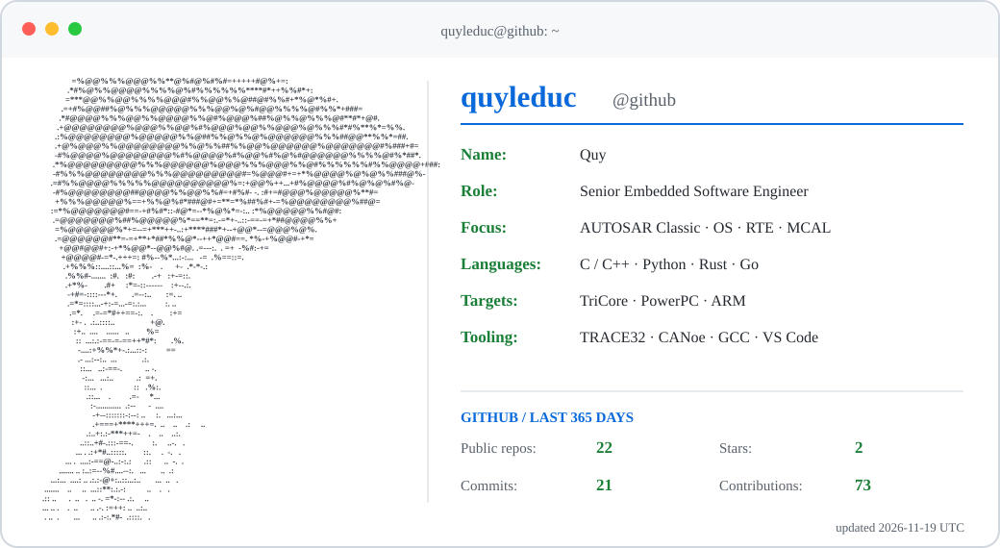
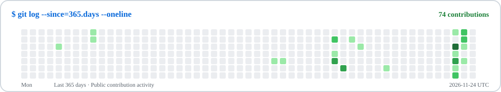

### `quyleduc@github:~$ whoami`

<picture>
  <source media="(prefers-color-scheme: dark)" srcset="./assets/neofetch-dark.svg" />
  
</picture>

### `quyleduc@github:~$ ./activity --last-year`

<picture>
  <source media="(prefers-color-scheme: dark)" srcset="./assets/heatmap-dark.svg" />
  
</picture>

### `> cat about.txt`

I'm **Quy**, a software engineer focused on **embedded systems, automotive software and developer tooling**. I enjoy building reliable low-level software and practical tools for complex engineering workflows.

- **Automotive:** AUTOSAR Classic, OS / RTE / MCAL, embedded C/C++, diagnostics and timing
- **Platforms:** Infineon AURIX, NXP PowerPC/S32K, STM32 and RP2040/RP2350
- **Tooling:** Python, Rust, Go, GitHub Actions, VS Code, CANoe, TRACE32
- **Interests:** Static analysis, real-time systems, AI-assisted development, open-source hardware

### `> ls ~/projects`

- **[AI PR Reviewer](https://github.com/quyleduc/coderabbit-ai-pr-reviewer)** — AI-assisted pull request review workflow and API integration.
- **[Ropener](https://github.com/quyleduc/Ropener)** — Open-source smart curtain opener hardware project.
- **[AUTOSAR with STM32F4](https://github.com/quyleduc/AUTOSAR-with-STM32F4)** — Embedded AUTOSAR exploration using STM32F4.
- **[SENT Analyzer Plugin](https://github.com/quyleduc/sent_analyzer_plugin)** — Signal analysis tooling for SENT experiments.

### `> printf 'Build • Measure • Debug • Improve\n'`

The ASCII portrait is generated from my own sketch. GitHub stats and the contribution calendar are refreshed automatically through [GitHub Actions](./.github/workflows/update-profile.yml), using public GitHub GraphQL data. Counts are scoped to **public repositories** and the **last 365 days** where indicated. Private repository data is not collected.
